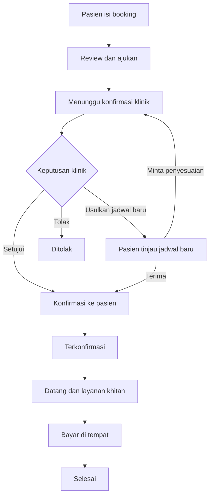

D# DESIGN.md — MyLaaTachzan Khitan

## 1. Tujuan dan referensi
Aplikasi permintaan mitra untuk pemesanan layanan khitan Klinik LaaTachzan. Referensi pengalaman booking bertahap: https://www.redboxbarbershop.com/ (pilihan layanan, tenaga profesional, dan pemesanan). Adaptasi alur untuk layanan kesehatan; tidak menyalin merek atau tampilan Redbox.

**Tagline:** Daftar Mudah, Khitan Nyaman, Keluarga Tenang.

## 2. Arah visual
Tema **Modern Minimalist Medical**, terinspirasi fasad abu-abu, putih, dan beige bangunan klinik.

| Token | Hex | Penggunaan |
|---|---|---|
| `--background` | `#E5E5E5` | Latar halaman utama |
| `--surface` | `#FFFFFF` | Card, formulir, dialog |
| `--surface-muted` | `#F5F5F5` | Panel sekunder |
| `--primary` | `#55575A` | Tombol utama dan navigasi |
| `--primary-hover` | `#414347` | Hover |
| `--accent` | `#C6A587` | Penanda aktif dan aksen |
| `--text` | `#333333` | Teks utama |
| `--text-muted` | `#6B7280` | Teks sekunder |
| `--border` | `#D1D5DB` | Border |
| `--success` | `#27805C` | Status berhasil |
| `--warning` | `#B7791F` | Status menunggu |
| `--error` | `#C24141` | Status gagal |

Font **Poppins**; radius card 16px, tombol 12px; shadow lembut. Hindari warna neon dan gradient mencolok. Pastikan kontras teks memenuhi WCAG AA.

## 3. Halaman utama
Navbar: Beranda, Paket Khitan, Cara Booking, Tentang Klinik, Kontak, Cek Booking. Hero: foto klinik, tagline, CTA **Booking Khitan**. Tampilkan 3 paket, alur booking, profil tenaga medis (jika tersedia), informasi jam layanan, dan FAQ. Desktop: konten max 1280px; mobile: satu kolom dan CTA booking mudah dijangkau.

## 4. Booking wizard — alur utama
Gunakan progress stepper, tombol **Kembali** dan **Lanjutkan**, simpan draft sementara secara aman, dan validasi per langkah.

### Langkah 1 — Quantity / jumlah pasien
- Pilih jumlah anak yang akan dikhitan, minimum 1.
- Buat formulir data anak terpisah untuk setiap pasien.
- Satu booking dapat berisi beberapa anak; satu kode booking induk dan identitas setiap anak.

### Langkah 2 — Data anak dan customer
**Data anak (sesuai KIA):** nama lengkap, NIK anak bila diperlukan dan disetujui klinik, tempat/tanggal lahir, jenis kelamin, nama orang tua/wali sesuai dokumen. Verifikasi field wajib dengan mitra terhadap KIA yang digunakan.
**Data customer/penanggung jawab:** nama lengkap, nomor WhatsApp aktif, alamat lengkap (jalan, RT/RW, desa/kelurahan, kecamatan, kabupaten, kode pos), catatan lokasi bila diperlukan.
**Data kesehatan tambahan opsional sesuai kebutuhan klinis:** alergi, riwayat penyakit, berat dan tinggi badan. Jangan mewajibkan unggah foto KIA kecuali benar-benar diperlukan dan memiliki dasar pemrosesan yang jelas.

### Langkah 3 — Paket dan metode khitan
- Tiga card paket: **Reguler**, **Premium**, **Super Premium**.
- Tiap card menampilkan harga, benefit, durasi estimasi, dan tombol pilih; semua nilai diambil dari data klinik.
- Pilihan **metode khitan** ditampilkan terpisah dari paket; metode yang tersedia berasal dari data klinik.
- Untuk banyak anak, jelaskan apakah paket dan metode berlaku per anak atau seragam untuk satu booking; default desain memungkinkan pilihan per anak.

### Langkah 4 — Pilih siapa yang menangani
- Card tenaga medis: nama, peran, foto opsional, deskripsi singkat, status ketersediaan.
- Pilih satu tenaga medis atau opsi **Ditentukan Klinik** jika mitra mengizinkan.
- Ketersediaan tenaga medis harus diverifikasi oleh klinik, tidak boleh dianggap pasti hanya dari pilihan pasien.

### Langkah 5 — Tanggal dan waktu layanan
- Kalender untuk memilih **tanggal khitan**.
- Pilihan waktu:
  1. **Pagi:** 06.00–08.00 WIB.
  2. **Sore:** 16.00–17.00 WIB.
  3. **Fleksibel:** menyesuaikan kesepakatan dengan klinik.
- Pagi dan sore adalah **rentang preferensi layanan**, bukan slot pasti sampai klinik mengonfirmasi jamnya.
- Pada pilihan fleksibel, sediakan kolom preferensi/catatan waktu.
- Cegah tanggal lampau; tampilkan ketidaktersediaan berdasarkan data yang sudah disinkronkan.
- Jika booking beberapa anak, jelaskan apakah semuanya dijadwalkan dalam satu kunjungan.

### Langkah 6 — Review booking
Tampilkan ringkasan: jumlah anak, data masing-masing anak, customer dan alamat, paket dan metode, tenaga medis, tanggal, preferensi waktu, estimasi biaya (jika tersedia), dan catatan. Checkbox persetujuan kebijakan privasi dan konfirmasi data. Tombol **Ajukan Booking**.

### Langkah 7 — Permintaan diterima sistem
- Buat nomor registrasi unik dan status **Menunggu Konfirmasi Klinik**.
- Tampilkan halaman sukses pengajuan; jangan menyebut booking telah final.
- Kirim notifikasi permintaan baru ke WhatsApp resmi LaaTachzan melalui integrasi yang disetujui; jika memakai tautan WhatsApp manual, tampilkan tombol **Kirim ke WhatsApp Klinik** dan jangan klaim terkirim otomatis.

### Langkah 8 — Verifikasi oleh LaaTachzan
- Admin memeriksa data, tenaga medis, jadwal, dan metode.
- Admin dapat **Setujui**, **Usulkan Jadwal Baru**, atau **Tolak** dengan alasan.
- Catat petugas dan waktu perubahan status.

### Langkah 9 — Konfirmasi kembali kepada pasien
- Pasien menerima informasi keputusan dan jadwal final.
- Jika ada perubahan, pasien memilih **Terima Jadwal Baru** atau **Minta Penyesuaian**.
- Status menjadi **Terkonfirmasi** setelah jadwal disepakati.

### Langkah 10 — Pembayaran di tempat
- Metode utama: **Bayar di Tempat**.
- Catatan metode pembayaran di lokasi: **Tunai, QRIS, atau Transfer**, sesuai opsi yang disediakan klinik.
- Tidak ada kewajiban pembayaran online di muka dalam alur ini.
- Admin menandai **Belum Dibayar / Sudah Dibayar** setelah transaksi aktual; berikan bukti pembayaran jika tersedia.

## 5. Diagram alur status

Notifikasi WhatsApp ke klinik dipicu setelah pengajuan baru; notifikasi pembaruan dikirim ketika status berubah, dengan memperhatikan persetujuan dan keandalan kanal.

## 6. Kode registrasi berdasarkan tanggal khitan
**Usulan format:** `KHT-YYYYMMDD-NNN`, contoh `KHT-20261105-001` untuk layanan tanggal 5 November 2026, urutan pertama pada tanggal tersebut.
- `YYYYMMDD` = **tanggal khitan yang diminta**, bukan tanggal pengisian form.
- `NNN` = nomor urut unik per tanggal, dialokasikan secara atomik agar tidak duplikat.
- Jika reschedule, **kode booking induk tetap** sebagai identitas stabil; tampilkan tanggal layanan terbaru di field terpisah. Jika mitra mewajibkan kode selalu mencerminkan tanggal terkini, gunakan **kode jadwal** terpisah yang dapat berubah dan simpan riwayat kode lama.
- Untuk booking banyak anak, gunakan ID anak/pasien terpisah di bawah satu booking; hindari duplikasi kode registrasi induk.
- Kode tidak boleh memuat NIK atau data medis.

## 7. Sumber data Excel
Excel adalah **sumber data operasional awal** yang diminta mitra. Untuk mencegah konflik pemesanan bersamaan, gunakan backend/database sebagai pencatat transaksi aktif, lalu impor/ekspor atau sinkronisasi Excel dengan kontrol versi. Jika harus Excel-only, pembaruan harus melalui satu layanan terpusat dengan locking dan validasi konflik; jangan mengandalkan browser menulis file Excel langsung.

**Struktur workbook yang disarankan:**
- `Customers`: customer_id, nama, whatsapp, alamat.
- `Children`: child_id, customer_id, nama_sesuai_kia, tanggal_lahir, atribut KIA yang disepakati.
- `Packages`: package_id, nama_paket, harga, benefit, durasi, aktif.
- `Methods`: method_id, nama_metode, aktif.
- `Providers`: provider_id, nama, peran, aktif.
- `Bookings`: booking_id, kode_registrasi, customer_id, jumlah_anak, tanggal_diminta, sesi_diminta, jam_final, provider_id, status, created_at, updated_at.
- `BookingChildren`: booking_id, child_id, package_id, method_id.
- `Payments`: payment_id, booking_id, metode, jumlah, status, paid_at.
- `StatusHistory`: booking_id, status_lama, status_baru, alasan, actor, timestamp.
- `Availability`: tanggal, sesi, provider_id, kapasitas, status.

**Ketentuan:** validasi format tanggal dan nomor HP; kontrol akses Excel; lindungi file karena berisi data anak; lakukan backup; jangan bagikan workbook berisi data medis lewat tautan publik; hindari formula injection saat ekspor nilai masukan pengguna.

## 8. Halaman admin
- **Dashboard:** pengajuan baru, jadwal hari ini, perlu konfirmasi, total booking.
- **Booking:** tabel dengan filter tanggal/status, detail booking, setujui/usulkan ulang/tolak.
- **Jadwal:** kalender pagi, sore, fleksibel; kapasitas dan tenaga medis.
- **Master Data:** paket, metode, tenaga medis, ketersediaan.
- **Pembayaran:** pencatatan pembayaran di tempat.
- **Excel:** impor, ekspor, riwayat sinkronisasi, laporan error data.
- **Notifikasi:** log pengiriman WhatsApp dan tombol kirim ulang jika gagal.

## 9. WhatsApp
Pesan ke klinik setelah booking diajukan, misalnya:

> Booking khitan baru: KHT-20261105-001. Tanggal diminta: 05/11/2026. Sesi: Pagi. Jumlah pasien: 2. Status: Menunggu Konfirmasi Klinik. Silakan buka dashboard untuk detail.

Hindari menyertakan NIK, riwayat penyakit, foto, atau informasi medis sensitif dalam notifikasi WhatsApp. Nomor tujuan WhatsApp resmi klinik diatur di konfigurasi, bukan hardcoded.

## 10. Responsif, UX, dan aksesibilitas
- Desktop: booking wizard terpusat, max-width 880px, summary sticky jika ruang cukup.
- Mobile: wizard satu kolom, progress ringkas, CTA di bagian bawah.
- Target sentuh minimum 44px, focus terlihat, label setiap input, kontras minimum 4.5:1 untuk teks biasa.
- Tampilkan loading, error, empty state, dan status sinkronisasi Excel.
- Konfirmasi klinik harus terlihat jelas; hindari janji slot pasti sebelum disetujui.

## 11. Batasan dan keputusan yang perlu dikonfirmasi mitra
1. Daftar field KIA yang benar-benar wajib.
2. Nama, harga, benefit tiga paket serta daftar metode khitan.
3. Daftar tenaga medis dan kapasitas per sesi.
4. Lokasi layanan: di klinik, kunjungan rumah, atau keduanya.
5. Apakah semua anak dalam satu booking wajib satu tenaga medis dan satu tanggal.
6. Apakah WhatsApp otomatis memakai API resmi atau tautan manual.
7. Apakah Excel menjadi master data saja atau satu-satunya penyimpanan.
8. Kebijakan pembatalan, reschedule, dan konfirmasi pembayaran.

**Prioritas implementasi:** landing page → booking wizard → nomor registrasi → dashboard konfirmasi klinik → notifikasi WhatsApp → pembayaran di tempat → impor/ekspor Excel.
